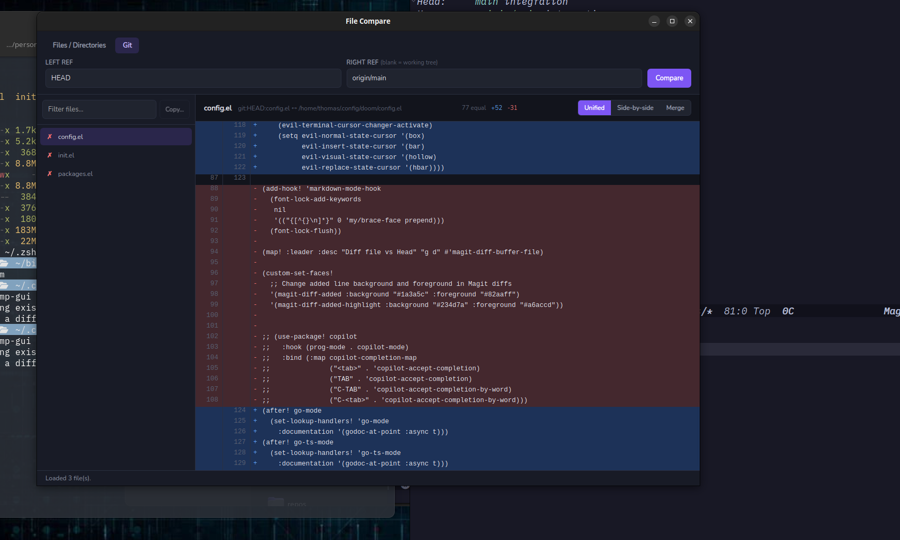

# katCompare

**Compare files, directories, and git refs — then merge just the changes you want. Also I wrote it to be easier for red/green colour blind people to use because I'm tired of all diff tools using at least by default red/green.**

katCompare is a fast, color-coded diff and merge tool written in Go that is clean looking and simple to use. It ships two ways from one engine: a **native desktop app** (Wails) and a **keyboard-driven terminal UI** (Bubble Tea).



<sub>The desktop GUI in Git mode, diffing `HEAD` against `origin/main` — changed files on the left, a color-coded unified diff on the right, with Side-by-side and Merge views one click away.</sub>

## Why katCompare?

- 🎨 **Diffs you can read at a glance** — blue for additions, red for deletions, with old/new line numbers and live `equal / +added / -deleted` counts
- 🌱 **Git-aware** — diff any ref against another ref, or against your working tree, without leaving the app
- 📁 **Whole-directory comparison** — recursively finds every text file on both sides and flags identical (✓), different (✗), and one-side-only files
- 🔀 **Cherry-pick merging** — choose individual lines or whole blocks of changes to apply and save them over the target file (the previous version is kept as `<file>.orig`)
- ⚔️ **Built-in git conflict resolver** — step through each `<<<<<<<` conflict, take ours, theirs or both, then save and mark it resolved (`git add`)
- 📋 **Directory sync** — copy files that exist on only one side into the other, in either direction
- 👥 **Unified or side-by-side** views, switchable instantly
- ✏️ **Hand off to your own tools** — open a file in your editor at the line you're looking at, send the pair to your external diff tool (meld, kdiff3, VS Code, nvimdiff…), or resolve git merge conflicts with `git mergetool`
- 🔎 **Filter and autocomplete** — narrow the file list by name, and get live path suggestions as you type
- 🖱️⌨️ **Your choice of interface** — point-and-click desktop app or vim-style (`j`/`k`) terminal UI, same results either way
- 🔍 **60+ text file types** recognized by name, plus any other file that looks like text (no binary content)

## Quick Start

### Download

- **Windows:** [**Download the installer**](https://github.com/devinthemtn/katCompare/releases/latest/download/katcmp-gui-windows-amd64-installer.exe) and double-click it. It installs katCompare for your user only, so you don't need admin rights, and adds Start menu and desktop shortcuts. The installer is unsigned, so Windows SmartScreen will ask you to click *More info → Run anyway*.
- **Other platforms:** the Linux GUI, the portable Windows GUI, and the terminal UI for Linux, macOS and Windows are on the [Releases page](https://github.com/devinthemtn/katCompare/releases/latest).

### Build and install both in one step

From the repository root (needs [go-task](https://taskfile.dev) — `go install github.com/go-task/task/v3/cmd/task@latest` — plus the GUI prerequisites below):

```bash
task install                          # builds TUI + GUI, installs to $(go env GOPATH)/bin
task install BINDIR=~/.local/bin      # or pick another directory on your PATH
```

This installs `katcmp` (TUI) and `katcmp-gui` (GUI). Use `task install-tui` / `task install-gui` for just one, and `task uninstall` to remove them.

> **Upgrading from File Compare?** The project was renamed to katCompare, and the commands changed from `filecmp` / `filecmp-gui` / `filecmp-win` to `katcmp` / `katcmp-gui` / `katcmp-win`. `task install` removes the old commands, launcher entry and Windows folder (`task uninstall-legacy` does just that). `FILECMP_EDITOR` still works, but `KATCMP_EDITOR` is the new name. If you used the old Windows installer, uninstall "File Compare" from Windows Settings → Apps.

**Under WSL**, `task install` also cross-compiles the Windows builds, installs `katcmp.exe` and `katcmp-gui.exe` to `%LOCALAPPDATA%\Programs\katCompare`, and adds a `katcmp-win` wrapper to `BINDIR`:

```bash
katcmp-win ./a ./b          # Windows GUI in a native window
katcmp-win --wait ./a ./b   # Windows GUI; returns when its window closes
katcmp-win --tui ./a ./b    # Windows TUI in this terminal
```

The wrapper converts path arguments to Windows paths. The plain GUI form returns immediately, so use `--wait` when another program runs `katcmp-win` as its diff tool (`git difftool`, katbackup's `diff_tool`): those delete their temporary files as soon as the command returns, before the GUI can read them (see [Using katCompare as a diff tool](#using-katcompare-as-a-diff-tool-wsl)). `katcmp-win --help` lists the options. Use `task install WSL=` to skip the Windows builds, or `WIN_INSTALL_DIR=/mnt/c/...` to install them somewhere else. `task build-windows` / `task build-gui-windows` just build them (output goes to `build/`).

### Desktop GUI

Requires Go 1.25+, Node.js, [go-task](https://taskfile.dev) and the [Wails v3 CLI](https://v3.wails.io):

```bash
go install github.com/wailsapp/wails/v3/cmd/wails3@latest
task build-gui         # Linux: needs GTK/WebKit -dev packages (see below)
./katcmp-gui/bin/katcmp-gui
./katcmp-gui/bin/katcmp-gui old.yaml new.yaml   # pre-fill both paths and compare right away
```

Pick the **Files / Directories** tab to compare two paths (type them, use the native file/folder picker, or pass them on the command line), or the **Git** tab to compare refs — leave the right ref blank to compare against the working tree.

### Terminal UI

```bash
go build -o katcmp
./katcmp                         # interactive path entry
./katcmp old.yaml new.yaml       # two files
./katcmp ./project-v1 ./project-v2   # two directories
./katcmp --git HEAD~1            # a git ref vs the working tree
```

---

## Desktop GUI (Wails)

The desktop app lives in [`katcmp-gui/`](katcmp-gui/). It imports the same diff/merge/file/git/external packages from the repository's `internal/` directory as the TUI, behind a mouse-driven interface built with [Wails](https://wails.io) — a Go backend with a vanilla HTML/CSS/JS frontend, no framework. Both share a single Go module; the TUI binary never imports Wails, so it doesn't pull in any GUI dependencies.

### GUI Features

- Compare two files or two directories (recursive, text-file-aware); the file list shows common files and files unique to either side, with identical/different indicators
- **Git mode**: diff a ref against another ref, or a ref against the working tree
- **Unified** and **side-by-side** diff views, color-coded like the TUI (blue = added, red = deleted)
- **Merge view**: tick which insertions/deletions to apply (per line, or ▾ for a whole block), then save over the target file; the old version is kept as `<file>.orig`. A side that is a git revision can't be a target
- **Conflicts view**: opens automatically for a conflicted file in git mode. Each conflict is a card showing Ours and Theirs; pick **Ours / Theirs / Both**, then **Save & mark resolved** (`git add`). Keys: `]`/`[` move, `o`/`t`/`b`/`B` choose, `u` undo
- **Copy**: copy files that exist on only one side into the other directory, in either direction
- Path autocomplete and native file/folder picker dialogs
- File-list filtering
- **External tools**: **Open left/right** (or **Open working copy** in git mode) opens the file in your editor; click any line number to open it at that line. **External diff** opens the pair in your diff tool, **Folders in diff tool** opens two compared directories, and **Merge tool** runs `git mergetool` on conflicted files (marked ⚠). Shortcuts: `e` = open, `d` = external diff. See [Editor & external diff tools](#editor--external-diff-tools)

### Building the GUI

Prerequisites: Go 1.25+, Node.js (for the Vite-built frontend), [go-task](https://taskfile.dev), and the Wails v3 CLI:

```bash
go install github.com/go-task/task/v3/cmd/task@latest
go install github.com/wailsapp/wails/v3/cmd/wails3@latest
```

**Linux only:** Wails also needs GTK/WebKit *development* headers to compile against (having the runtime libraries installed isn't enough — `pkg-config` needs the `-dev` packages, or the Go build fails with a cgo/`pkg-config` error). On Debian/Ubuntu:

```bash
sudo apt install libgtk-3-dev libwebkit2gtk-4.1-dev
```

Run `wails3 doctor` to check what's missing on your system.

Then, from the repo root:

```bash
task dev-gui     # live development with hot reload
task build-gui   # production binary in katcmp-gui/bin/
task install-gui # build and install to $(go env GOPATH)/bin (+ Linux launcher entry)
```

The GUI's own Wails v3 Taskfiles live in `katcmp-gui/` (`Taskfile.yml` and `build/*/Taskfile.yml`), so `wails3 build` / `wails3 dev` also work from inside that directory.

#### Linux: GTK version

Wails v3 defaults to GTK4 + WebKitGTK 6.0 on Linux. This project builds with the `gtk3` tag instead (set as the default `EXTRA_TAGS` in `katcmp-gui/build/linux/Taskfile.yml`), so it links against GTK3 + WebKitGTK 4.1 — the packages above, available on most current distros (e.g. Ubuntu 24.04). To build against GTK4 instead, install `libgtk-4-dev libwebkitgtk-6.0-dev` and remove that `gtk3` default.

Because of the tag, plain `go build ./...` / `go vet ./...` at the repo root fail on Linux in the `katcmp-gui` package; use `go build -tags gtk3 ./...` / `go test -tags gtk3 ./...` (the tasks, including `task test`, handle this for you).

#### Building for Windows

**On Windows**, with Go, go-task and the Wails v3 CLI installed, just run `task build-gui` (or `wails3 build` in `katcmp-gui/`) — no extra setup needed. It uses WebView2 (present by default on current Windows 10/11).

**Cross-compiling from Linux/WSL** needs no extra compiler, since the Windows build doesn't use cgo. From the repository root:

```bash
task build-gui-windows     # → build/katcmp-gui-windows-amd64.exe
task build-win-installer   # → build/katcmp-gui-windows-amd64-installer.exe (needs: sudo apt install nsis)
```

The installer installs katCompare for the current user into `%LOCALAPPDATA%\Programs\katCompare`, with no admin prompt. It adds Start menu and desktop shortcuts and an uninstall entry in *Apps & features*. It's unsigned, so Windows SmartScreen asks users to click *More info → Run anyway*. Its product name and version come from the `info` section of `katcmp-gui/build/config.yml`. Bump `version` there when you release, then run `task update-gui-assets` to regenerate the derived files (`build/windows/info.json`, the NSIS defines, macOS `Info.plist`). That regeneration overwrites `build/windows/nsis/project.nsi`, so re-add the `MUI_FINISHPAGE_RUN` line (the "Run katCompare" checkbox) afterwards. The installer also installs WebView2 if it's missing.

#### Building for macOS

Wails does not support cross-compiling to macOS from Linux or Windows (it needs Apple's Cocoa/WebKit frameworks and `clang` with the macOS SDK). Build directly on a Mac with `task build-gui`.

### GUI project structure

```
katcmp-gui/
├── app.go               # Wails service: LoadComparison, LoadGitComparison,
│                        # GetDiff, SaveMerge, CopyFiles, SuggestPaths, dialogs
├── main.go              # application.New(...) entrypoint
│                        # (logic packages are imported from the root internal/)
├── Taskfile.yml         # Wails v3 build tasks (called by the root Taskfile)
├── build/               # config.yml (product info), icons, per-platform Taskfiles,
│                        # NSIS installer, Linux .desktop template
└── frontend/
    ├── index.html
    ├── bindings/        # generated by wails3 (gitignored)
    └── src/
        ├── main.js      # view state machine, rendering, all UI logic
        └── style.css
```

### GUI notes

- Copy mode is unavailable when comparing git refs, since the compared "roots" are synthetic (commit contents / working tree), not real directories to copy into.

---

## Terminal UI

The TUI is a full-screen, keyboard-driven interface built with [Bubble Tea](https://github.com/charmbracelet/bubbletea) and [Lip Gloss](https://github.com/charmbracelet/lipgloss). It adapts to terminal resizes and supports vim-style navigation.

### Installation

```bash
git clone <repository-url>
cd katCompare
go build -o katcmp     # or: task deps && task build
```

### Command Line Options

```bash
# Start with interactive file selection
./katcmp

# Compare two files directly
./katcmp file1.txt file2.txt

# Compare two directories (finds common files automatically)
./katcmp ./project-v1 ./project-v2

# Load left file, enter right path in TUI
./katcmp /path/to/file1.txt

# Compare HEAD against the working tree (must be run inside a git repo)
./katcmp --git

# Compare a ref against the working tree (includes staged changes)
./katcmp --git HEAD~1

# Compare two refs against each other
./katcmp --git HEAD~3 HEAD

# Show comprehensive help
./katcmp --help
```

### Quick Start with Task

```bash
# Install dependencies and build
task deps && task build

# Try the demo with example files
task demo

# Demo the merge functionality
task demo-merge

# Quick test with sample files
task run-files

# Quick test with sample directories
task run-dirs
```

### Interactive Controls

#### File Selection Mode
- **Tab**: Switch between left/right input fields and the View Diff / Quit buttons, or cycle through path suggestions when they're showing
- **Enter**: Accept a highlighted path suggestion, load the focused input's path, or activate the focused button
- **↑/↓**: Navigate suggestions (when showing) or the list of all files (common and unique)
- **/**: Filter the file list by name (type to narrow, Backspace to edit, Esc to clear)
- **Ctrl+D**: Start comparing the selected files
- **?**: Show help screen
- **q/Ctrl+C**: Quit application

Path autocomplete kicks in automatically as you type in either input field, suggesting matching files/directories from the filesystem (press Tab or ↑/↓ to cycle, Enter to accept).

#### Diff View Mode (Unified & Side-by-Side)
- **↑/↓** or **j/k**: Navigate through diff lines
- **h/l** or **←/→**: Scroll left/right (side-by-side view only)
- **s**: Switch view mode (Unified ↔ Side-by-Side)
- **g**: Go to top of diff
- **G**: Go to bottom of diff
- **]** / **[**: Jump to the next / previous change
- **n**: Next file
- **p**: Previous file
- **m**: Enter merge mode (only for files that exist on both sides); on a git conflict it opens the conflict resolver
- **c**: Enter copy mode (only available when the loaded directories have unique files)
- **e**: Edit the right file (the working tree file in git mode) at the cursor line
- **E**: Edit the left file at the cursor line
- **D**: Open the file pair in your external diff tool
- **R**: Resolve a git merge conflict with `git mergetool` (conflicted files show ⚠ **[CONFLICT]**)
- **Esc**: Return to file selection
- **?**: Show help screen
- **q/Ctrl+C**: Quit application

#### Merge Mode
- **↑/↓** or **j/k**: Navigate through diff lines
- **]** / **[**: Jump to the next / previous change
- **Space**: Toggle the change on the current line
- **Enter**: Toggle the whole block of changes
- **t**: Switch merge target (left/right file; a git revision can't be a target)
- **a**: Select all changes
- **n**: Select no changes
- **s**: Save over the target file (the previous version is kept as `<file>.orig`)
- **Esc**: Return to diff view
- **?**: Show help screen
- **q/Ctrl+C**: Quit application

#### Conflict Mode (`m` on a git conflict)
- **↑/↓**, **j/k** or **]**/**[**: Move between conflicts
- **o** / **t**: Take ours / theirs
- **b** / **B**: Take both (ours first / theirs first)
- **u**: Undo the choice
- **O** / **T**: Take ours / theirs for every conflict
- **s**: Save the chosen resolutions (unresolved conflicts keep their markers)
- **A**: Save and mark resolved (`git add`)
- **e**: Edit the file at the current conflict
- **R**: Resolve in your external merge tool instead
- **Esc**: Return to diff view

#### Copy Mode (Directory Comparison Only)
- **↑/↓** or **j/k**: Navigate through unique files
- **Space/Enter**: Toggle selection of current file to copy
- **t**: Switch copy target (to-left ↔ to-right)
- **a**: Select all unique files
- **n**: Select no files
- **s**: Copy selected files to target directory
- **Esc**: Return to diff view
- **?**: Show help screen
- **q/Ctrl+C**: Quit application

> Copy mode is entered with **c** from the diff view (not from file selection).

## Editor & external diff tools

Both the GUI and the TUI can hand the current file off to other apps.

**Editor.** The first one found is used:
1. `$KATCMP_EDITOR`
2. `$VISUAL`
3. `$EDITOR`
4. the OS default app (`xdg-open` / `open` / `start`)

The value can include arguments, for example `KATCMP_EDITOR="code --wait"`. The GUI has no terminal, so it skips terminal-only editors (`nvim`, `emacsclient -t`, `nano`, …) and moves on to the next choice. The TUI prefers terminal editors: if `$VISUAL` is a GUI editor (e.g. `emacsclient -c`) and `$EDITOR` runs in a terminal (e.g. `emacsclient -t`), the TUI uses `$EDITOR`. `$KATCMP_EDITOR` always wins. The TUI suspends itself while a terminal editor runs. Jumping to a line works for vi/vim/nvim, emacs/emacsclient, nano, micro, VS Code, Zed, Sublime and Helix.

**Diff and merge tools** come from your git config, so set them once:

```bash
git config --global diff.tool meld       # or kdiff3, vscode, nvimdiff, bc, ...
git config --global merge.tool meld
git config --global diff.guitool meld    # optional: GUI-only choice (e.g. diff.tool = nvimdiff for the TUI)
```

The **TUI prefers terminal tools** (vimdiff, nvimdiff, or a custom `difftool.<name>.cmd` that runs a terminal program such as `emacsclient -nw`). It checks `diff.tool`, then `diff.guitool`, then any installed nvim/vim. It only uses a GUI tool when it can't find a terminal one. The **GUI** checks `diff.guitool`, then `diff.tool`, and always skips terminal tools. Merge tools follow the same rules with `merge.tool` / `merge.guitool`.

- **Git mode** runs `git difftool <ref> [<ref>] -- <file>`.
- **Plain files and folders** don't need to be in a git repository. Files are passed to `git difftool --no-index`, which works anywhere. If git isn't installed or no tool is configured, the app launches the tool directly: a `difftool.<name>.cmd` you've defined, or the first of meld / kdiff3 / VS Code it finds (nvim/vim `-d` too, but only in the TUI). A file that exists on only one side is compared against an empty file.
- **Whole folders** open directly in tools that support directories (meld, kdiff3, Beyond Compare).
- **Merge conflicts**: in git mode (ref vs working tree), files with unresolved conflicts during a merge or rebase are marked ⚠. Resolve them in the built-in conflict view (GUI **Conflicts**, TUI `m`), or with **Merge tool** / `R`, which runs `git mergetool -- <file>` and then reloads the list.

### Using katCompare as a diff tool (WSL)

To have another program open its comparisons in the Windows GUI, run `katcmp-win --wait`:

```bash
# git difftool
git config --global diff.tool katcmp
git config --global difftool.katcmp.cmd 'katcmp-win --wait "$LOCAL" "$REMOTE"'
```

```toml
# katbackup: ~/.config/katbackup/config.toml
diff_tool = 'katcmp-win --wait "$LOCAL" "$REMOTE"'
```

`--wait` keeps `katcmp-win` running until you close the window, and the calling program pauses until then. Without it, `katcmp-win` returns immediately and the calling program deletes its temporary files, so the GUI stays on "Nothing loaded yet" and the status bar reports that a path can't be found.

## Color Legend

### Diff Colors
- **Blue background**: Added lines (+)
- **Red background**: Deleted lines (-)
- **Gray text**: Unchanged lines
- **Yellow background**: Selected changes (merge mode)
- **Strikethrough text**: Unselected changes (merge mode)

### File Status Indicators
- **✓ Green checkmark**: Identical files (same content in both directories)
- **✗ Red X**: Different files (content differs between directories)
- **◄ Blue arrow**: File exists only in LEFT directory **[LEFT ONLY]**
- **► Orange arrow**: File exists only in RIGHT directory **[RIGHT ONLY]**
- **⚠ Yellow warning**: File has unresolved git merge conflicts **[CONFLICT]**

## 📄 Supported File Types

Files with any of the 60+ extensions or names below are always treated as text. Any other file is still compared if its content looks like text — the same heuristic git uses: it's non-empty and has no NUL bytes in the first 8000 bytes. So `.lock`, `.tf`, `.vue`, extensionless scripts, etc. work fine, while images, archives, and compiled binaries are skipped.

### Programming Languages
`.go` `.js` `.ts` `.py` `.java` `.c` `.cpp` `.h` `.hpp` `.rs` `.swift` `.kt` `.cs` `.vb` `.fs` `.php` `.rb` `.scala` `.clj` `.hs` `.elm` `.pl` `.pm` `.r` `.R` `.m`

### Web & Data Files
`.html` `.htm` `.css` `.xml` `.json` `.yaml` `.yml` `.toml` `.csv`

### Documentation & Text
`.txt` `.md`

### Configuration & Scripts
`.sql` `.ini` `.cfg` `.conf` `.config` `.properties` `.env` `.sh` `.bash` `.zsh` `.fish` `.ps1` `.bat` `.cmd`

### Build & Project Files
`.dockerfile` `.makefile` `.cmake` `.ninja` `.gradle` `.pom` `.gitignore` `.gitattributes` `.editorconfig`

### Special Files (no extension, matched case-insensitively)
`README` `LICENSE` `CHANGELOG` `AUTHORS` `CONTRIBUTORS` `Makefile` `Dockerfile` `Gemfile` `Rakefile` `Procfile`

> Note: hidden files (names starting with `.`) are skipped during directory scans, so a bare `.gitignore` won't show up when comparing directories even though its extension is on the supported list.

## How It Works

1. **Load Paths**: Enter file or directory paths in the input fields (with live autocomplete), or use `--git` to diff against a git ref/working tree
2. **Analyze All Files**: For directories, the tool finds ALL text files from both locations
3. **Categorize Files**: Files are marked as common (both sides), left-only, or right-only
4. **Select File**: Choose any file to compare using the arrow keys, optionally filtering the list with `/`
5. **View Diff**: See the comparison with color-coded changes
6. **Navigate**: Move through all files (common and unique) seamlessly
7. **Merge Changes**: Press 'm' to enter merge mode (only for common files)
8. **Save Results**: Choose which changes to keep and save the merged file

## Examples

### Comparing Two Files
```bash
./katcmp config.old.yaml config.new.yaml
```

### Comparing Project Directories
```bash
./katcmp ./project-v1 ./project-v2
```
This will find all files from both directories and allow you to compare them, merge changes, and copy unique files.

### Interactive Mode
```bash
./katcmp
```
Then enter paths interactively using the TUI.

### Comparing Against Git
```bash
# HEAD vs working tree (includes staged and unstaged changes)
./katcmp --git

# A specific commit vs working tree
./katcmp --git HEAD~1

# Two commits/refs against each other
./katcmp --git main feature-branch
```

### Copy Unique Files Between Directories
```bash
# Compare directories, then from the diff view press 'c' to enter copy mode
./katcmp old-project/ new-project/
# Select files to copy and press 's' to copy them
```

## 🏗️ Architecture

### Core Components
- **TUI Layer**: Built with [Bubble Tea](https://github.com/charmbracelet/bubbletea) for responsive terminal interface
- **Styling**: [Lip Gloss](https://github.com/charmbracelet/lipgloss) for beautiful colors and layouts
- **Diff Engine**: LCS-based line-level diff for accurate comparisons
- **File System**: Smart file detection and recursive directory traversal
- **Git Integration**: Shells out to `git` to diff refs/working tree for `--git` mode

### Project Structure
```
internal/
├── ui/         # TUI state, key handling (model.go) and rendering (views.go)
├── differ/     # Diff computation engine
├── merge/      # Merge functionality and change selection
├── file/       # File operations and type detection
├── git/        # Git ref / working-tree comparison support (--git mode)
└── external/   # Launching editors and external diff/merge tools

katcmp-gui/    # Wails desktop GUI (same Go module, imports internal/) — see "Desktop GUI (Wails)" above
examples/       # Sample files for testing
```

## 🎛️ Advanced Usage

### Keyboard Shortcuts Summary
| Key | File Selection | Diff View | Side-by-Side | Merge Mode | Copy Mode | Description |
|-----|----------------|-----------|--------------|------------|-----------|-------------|
| `Tab` | ✅ | ❌ | ❌ | ❌ | ❌ | Switch input fields / cycle suggestions |
| `Enter` | ✅ | ❌ | ❌ | ✅ | ✅ | Load entered path / Toggle change block / Toggle file |
| `↑/↓` | ✅ | ✅ | ✅ | ✅ | ✅ | Navigate lists/lines |
| `j/k` | ❌ | ✅ | ✅ | ✅ | ✅ | Vim-style navigation |
| `h/l` or `←/→` | ❌ | ❌ | ✅ | ❌ | ❌ | Scroll left/right |
| `g/G` | ❌ | ✅ | ✅ | ❌ | ❌ | Jump to top/bottom |
| `]/[` | ❌ | ✅ | ✅ | ✅ | ❌ | Jump to next/previous change |
| `/` | ✅ | ❌ | ❌ | ❌ | ❌ | Filter file list |
| `s` | ❌ | ✅ | ✅ | ✅ | ✅ | Switch view mode / Save result / Copy files |
| `n/p` | ❌ | ✅ | ✅ | ❌ | ❌ | Next/previous file |
| `m` | ❌ | ✅ | ✅ | ❌ | ❌ | Enter merge mode / conflict resolver |
| `c` | ❌ | ✅ | ✅ | ❌ | ❌ | Enter copy mode |
| `e`/`E` | ❌ | ✅ | ✅ | ❌ | ❌ | Edit right/left file in your editor |
| `D` | ❌ | ✅ | ✅ | ❌ | ❌ | Open in external diff tool |
| `R` | ❌ | ✅ | ✅ | ❌ | ❌ | Resolve git conflict with mergetool |
| `t` | ❌ | ❌ | ❌ | ✅ | ✅ | Switch merge/copy target |
| `a` | ❌ | ❌ | ❌ | ✅ | ✅ | Select all changes/files |
| `Space` | ❌ | ❌ | ❌ | ✅ | ✅ | Toggle current change/file |
| `Ctrl+D` | ✅ | ❌ | ❌ | ❌ | ❌ | Start comparison |
| `Esc` | ❌ | ✅ | ✅ | ✅ | ✅ | Return to previous view |
| `?` | ✅ | ✅ | ✅ | ✅ | ✅ | Show help screen |
| `q`/`Ctrl+C` | ✅ | ✅ | ✅ | ✅ | ✅ | Quit application |

### Performance Tips
- Large files (>10MB) may take a moment to process
- Directory comparisons are optimized to only load text files
- The diff algorithm uses semantic cleanup for better readability

## License

MIT License - see [LICENSE](LICENSE) file for details.

## 🧪 Testing

Run the included test suite:
```bash
# Run Go unit tests
task test

# Try with examples
task demo
```

## 🚀 Building from Source

Build tasks use [go-task](https://taskfile.dev) (`go install github.com/go-task/task/v3/cmd/task@latest`); run `task --list` to see them all.

```bash
# Clone and build
git clone https://github.com/devinthemtn/katCompare.git
cd katCompare
task deps
task build

# Or build for multiple platforms
task build-all

# Install TUI + GUI to $(go env GOPATH)/bin (optional)
task install
```

## 🤝 Contributing

Contributions are welcome! Areas for improvement:
- Additional file type support
- Syntax highlighting within diffs
- Copy operation undo/rollback
- Export diff results
- Configuration file support
- Undo/redo for merge operations
- Directory structure visualization

Please feel free to submit issues, feature requests, or pull requests.

## 📋 Roadmap

- [x] Interactive merge mode with selective change application
- [x] Complete directory analysis (all files, not just common ones)
- [x] File source identification with clear indicators
- [x] Copy mode for easily copying unique files between directories
- [x] Side-by-side comparison view with unified/split toggle
- [x] File filtering by name
- [x] Path autocomplete
- [x] Integration with Git for ref/working-tree diffs
- [x] Built-in git merge conflict resolution
- [x] Native desktop GUI (Wails) — see [Desktop GUI (Wails)](#desktop-gui-wails)
- [ ] Syntax highlighting for code diffs
- [ ] Three-way merge support
- [ ] Export diffs to HTML/PDF
- [ ] Configuration file support
- [ ] Plugin system for custom file types
- [ ] Undo/redo functionality in merge mode
- [ ] Directory tree visualization
